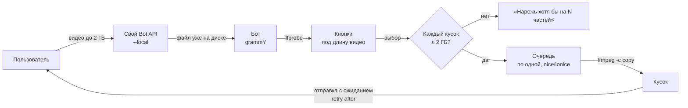

<div align="center">


# Video Cutter

**Telegram-бот: нарезка видео до 2 ГБ прямо в чате**<br>
<sub>Telegram bot that cuts videos up to 2 GB on its own server with ffmpeg — no re-encoding, chunks delivered one by one</sub>

[](https://t.me/VideoCutterRobot)


**[▶ Попробовать в Telegram](https://t.me/VideoCutterRobot)**

</div>

---

Присылаешь видео (до 2 ГБ, любой длины) и нажимаешь кнопку: по минуте, на равные части, каждые N секунд или вырезать один кусок. Куски приходят по одному прямо в чат, без перекодирования и потери качества.

### 📈 В работе

На 12.11.2026, без владельца: **94 человека** открывали бота, **61** за последние 30 дней. Сделано **369 нарезок**, из них **83 за последнюю неделю**. Самое длинное присланное видео шло 28 часов, самое тяжёлое весило 4,2 ГБ.

## 🎬 Для пользователя

1. Подписаться на канал-вход (если он включён) и нажать «Я подписался».
2. Прислать видео: файлом или обычным видео.
3. Выбрать в кнопках, как резать. Кнопки подстроены под длину ролика: короткому не предлагаются 5-минутные интервалы. Можно и текстом:

| Пишешь | Что получится |
|---|---|
| `от 1:30 до 2:45` | один кусок с 1:30 по 2:45 |
| `каждые 60` / `каждые 2м` | куски по 60 секунд / по 2 минуты |
| `поминутно` | куски по минуте |
| `на 5 частей` | 5 равных частей |

Время можно писать как `90`, `1:30`, `01:02:03`, `1м30с`, `1h30m`.

## ✨ Возможности

- **Без перекодирования** (`ffmpeg -c copy`): быстро даже для многочасовых видео, процессор почти не загружен. Если звук в формате, которого нет в mp4 (pcm, dts…), видео остаётся как есть, а звук перекодируется в AAC.
- **Большие файлы до 2 ГБ** через свой сервер [telegram-bot-api](https://github.com/tdlib/telegram-bot-api) в режиме `--local`: обычный облачный Bot API разрешает боту скачивать до 20 МБ и отправлять до 50 МБ.
- **Очередь по одной задаче** с низким приоритетом (`nice -n 15`, `ionice -c 3`): нарезка не мешает другим сервисам на том же сервере. На человека — одна активная задача.
- **Файлы не копятся:** каждый кусок удаляется сразу после отправки, исходник — когда задача закончилась.
- **Вход по подписке** на канал (необязательно), владелец без ограничений, `/stats` для владельца.
- **Ошибки объясняются по-человечески**, а владелец получает настоящую причину (без путей и токена).

## 🏗 Как устроено



| Файл | Что делает |
|---|---|
| `src/index.ts` | бот: вход, приём видео, кнопки, запуск и ход нарезки, отправка |
| `src/parse.ts` | разбор тайм-кодов и команд нарезки в отрезки |
| `src/keyboard.ts` | кнопки под конкретную длину видео |
| `src/ffmpeg.ts` | ffmpeg/ffprobe: нарезка в две попытки, таймаут, низкий приоритет |
| `src/limits.ts` | пределы Telegram: оценка размера кусков, время на кусок, «подожди N секунд» |
| `src/safe.ts` | тексты ошибок для человека, вычищение токена и путей из ошибок |
| `src/queue.ts` | очередь задач (защита сервера) |
| `src/db.ts` | SQLite: задачи, события, кто прошёл вход |
| `src/config.ts` | настройки из `.env` |

### Данные

База SQLite (`DB_PATH`), три таблицы:

| Таблица | Что лежит |
|---|---|
| `jobs` | каждая нарезка: кто, длительность, вид (`every` / `parts` / `range`), сколько кусков, статус (`done` / `error` / `cancelled`), причина, время |
| `events` | шаги пользователей: `start`, `video_in` (длительность и размер), `done`, `cut_err`… |
| `gate_passed` | кто уже прошёл вход по подписке |

Сами видео в базу не попадают и на диске не задерживаются.

## 🧠 Инженерные решения и пределы

| Ситуация | Что делает бот |
|---|---|
| Telegram просит «подожди N секунд» | Ждёт N + 1 секунду и отправляет кусок снова, до 5 попыток. Между кусками пауза в секунду. Свой Bot API присылает это как `400 … retry after N`, а не как `429`, поэтому бот смотрит на текст ошибки |
| Кусок выйдет больше 2 ГБ | Ещё **до** нарезки бот говорит, на сколько частей минимум резать (оценка по доле длительности с запасом 10%). После нарезки точный размер проверяется ещё раз |
| Большой кусок режется долго | На кусок отводится 5 минут + минута на каждые 200 МБ |
| Необычный формат внутри файла | Вторая попытка: видео как есть, звук в AAC. Не вышло — понятное сообщение |
| Человек заблокировал бота посреди нарезки | Задача помечается `cancelled`, это не считается сбоем |
| Любая другая ошибка | Человеку — понятный текст, владельцу — причина без путей и токена |

Предел размера — свойство Telegram, а не сервера: через свой Bot API бот отправляет файлы до 2000 МБ.

## ⚙️ Настройки (`.env`)

| Переменная | Что это |
|---|---|
| `BOT_TOKEN` | токен от @BotFather |
| `BOT_API_ROOT` | адрес своего Bot API, например `http://127.0.0.1:8082`. Пусто — облачный, лимит 20/50 МБ |
| `BOTAPI_DIR_CONTAINER` | где Bot API хранит файлы внутри контейнера (`/var/lib/telegram-bot-api`) |
| `BOTAPI_DIR_HOST` | тот же каталог на сервере (том контейнера) |
| `DATA_DIR` | рабочая папка: временные куски |
| `DB_PATH` | путь к базе SQLite |
| `OWNER_ID` | Telegram id владельца: без лимитов, `/stats`, уведомления о сбоях |
| `CHANNEL` | канал-вход, например `@channel`. Пусто — без проверки подписки |
| `MAX_CONCURRENT` | сколько задач резать одновременно (по умолчанию 1) |

Пример — `.env.example`. Сам `.env` в репозиторий не попадает.

## 🚀 Установка

Нужны Node.js 22+, ffmpeg (с ffprobe) и для больших файлов — свой `telegram-bot-api`:

```bash
docker run -d --name tg-bot-api --restart unless-stopped \
  -p 127.0.0.1:8082:8081 \
  -e TELEGRAM_API_ID=<api_id> -e TELEGRAM_API_HASH=<api_hash> -e TELEGRAM_LOCAL=1 \
  -v /path/botapi:/var/lib/telegram-bot-api \
  aiogram/telegram-bot-api:latest
```

`api_id` и `api_hash` берутся на [my.telegram.org](https://my.telegram.org). Перед первым запуском через свой Bot API бота нужно один раз вывести из облака: `curl https://api.telegram.org/bot<токен>/logOut`.

```bash
cp .env.example .env   # заполнить BOT_TOKEN и пути
npm install
npm test               # 39 тестов
npm start
```

На сервере бот работает под pm2: `pm2 start npm --name video-cutter -- start`.

## 🎛 Эксплуатация

| Задача | Команда |
|---|---|
| Состояние | `pm2 status video-cutter` |
| Журнал | `pm2 logs video-cutter --lines 50` |
| Статистика | `/stats` в боте (только владелец) |
| Перезапуск | `pm2 restart video-cutter` — сначала убедиться, что нет задач в работе (`jobs.status = 'running'`) |
| Выкладка | скопировать `src/` и `package*.json`, затем `npx tsc --noEmit` и `pm2 restart video-cutter` |
| Проверка, что бот слушает | `getWebhookInfo` у своего Bot API: `pending_update_count` должен быть 0 |

Перед выкладкой стоит сделать копию: `tar czf backup.tgz src package*.json`.

## 📜 История сбоев (чему научил бот)

- **`-to` вместо `-t`** — при `-ss` перед `-i` параметр `-to` считается длительностью, и куски налезали друг на друга. Исправлено на `-t = to − from` (13.09.2026).
- **Код 234 «Could not find tag for codec none»** — служебные потоки камер (таймкод, телеметрия) не помещаются в mp4. Теперь берутся только видео и звук (21.10.2026).
- **«too Many Requests: retry after 8»** — 12 упавших нарезок с 10–15 кусками: бот сдавался вместо ожидания (26.10–03.11.2026). Теперь ждёт и повторяет.
- **`FILE_PARTS_INVALID`** — видео 3,5–4 ГБ резали на 2 части больше 2 ГБ каждая (24.10–30.10.2026). Теперь проверка до нарезки.
- **ffmpeg не уложился в 5 минут** на кусок около 2 ГБ (24.10.2026). Теперь время зависит от размера.

## 🗺 Планы

- Пресеты для шортсов, вертикальный кроп 9:16, кадры-превью.
- «Умная» нарезка: пропуск тишины (`silencedetect`), поиск ярких моментов по громкости и смене сцен.

## 📄 Лицензия

[MIT](LICENSE) © digmen
